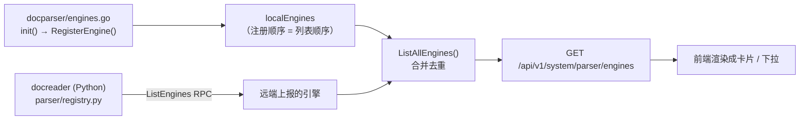
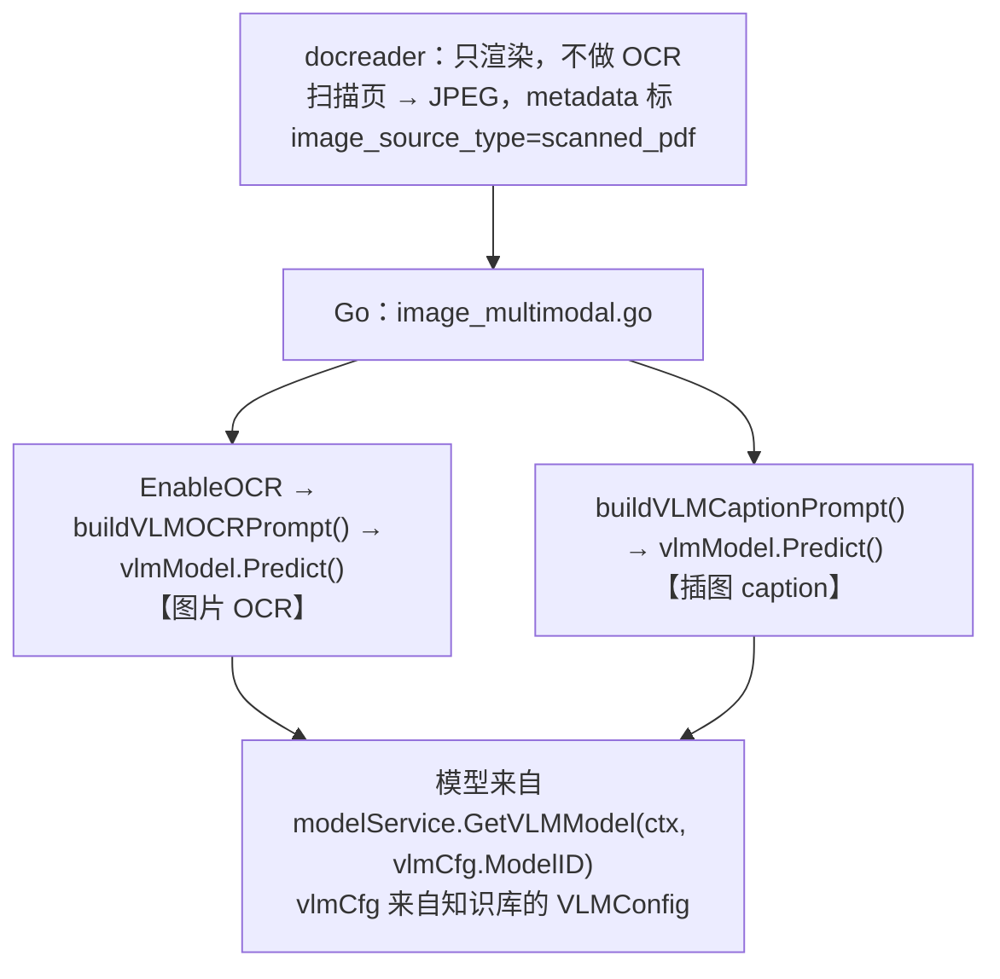
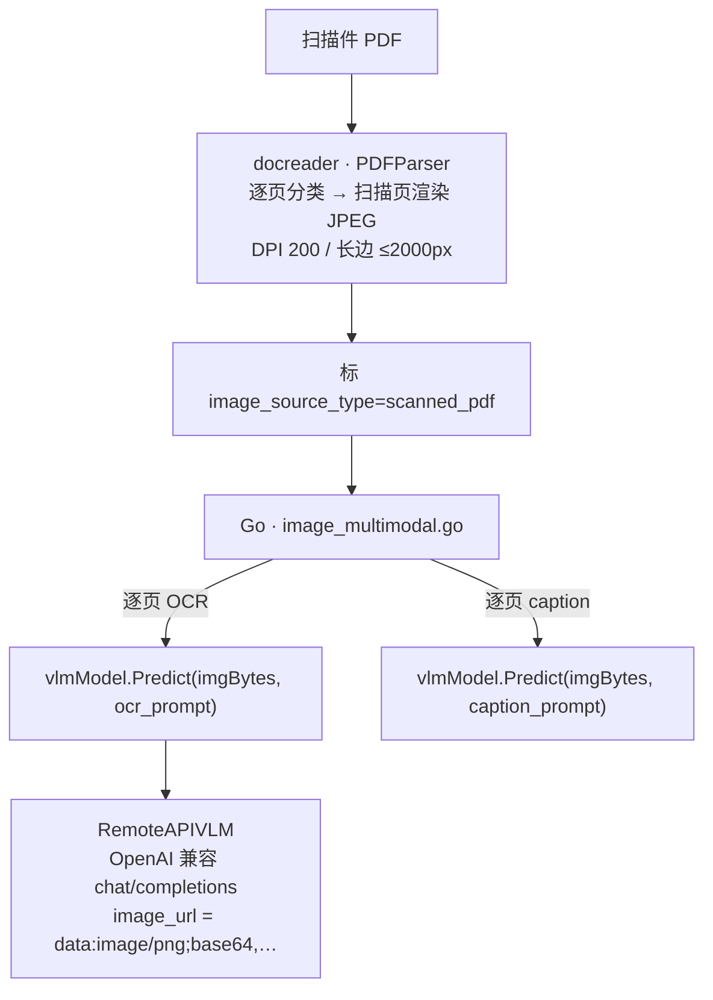

# WeKnora 解析引擎接入机制

> **适用问题**：「我想让 WeKnora 用某个外部文档解析 / OCR 服务，该在哪配？」
> **引用基线**：`@993d6560`（`wkj-dev`）。行号会随手漂移，核对时以符号名为准。

## 一、结论速览

1. **引擎列表由后端注册表产出**，前端只渲染 —— 想让「列表里多一个引擎」，改的是**后端**，不是前端某个配置项。
2. 引擎分两类：**Go 侧本地引擎**（能配 endpoint）与 **docreader 侧 Python 引擎**（**没有** endpoint 概念）。判据见 §三。
3. 接外部服务只有两条路：**对齐 WeKnora 已支持的协议**（零代码），或 **新增一个 Go 侧引擎**（要改官方文件）。
4. ★ **图片 OCR 不在解析引擎体系内** —— 它走知识库的「视觉模型」（协议仅 OpenAI / Ollama），
   docreader 侧**没有**任何 OCR 配置项。见 §六。
5. ★★ **扫描件 PDF 的拆页已由 docreader 完成**（逐页渲染成 JPEG），Go 侧只做「最后一跳」的图片 OCR；
   而这一跳是**标准 OpenAI 兼容调用** ⇒ 让外部服务满足该协议即可**用「模型」配置接管**，
   WeKnora 零源码改动。见 §八。
   > ⚠️ 判据本身成立（是机制），但由它推出的**方案已不采用** —— 原定路径是
   > **PP-StructureV3**（走 `paddleocr_vl` 引擎，同样零代码、且附带版面结构）。
   > ★ **该服务当前已停止**（2026-09-23），同机改跑 MinerU 4.0.6；
   > 状态与恢复见 `15-docreader定制/PP-StructureV3-接入与运维（南宁110）.md` §七。

---

## 二、引擎列表从哪来

列表 = **Go 侧本地注册表** + **docreader 经 `ListEngines` RPC 上报的引擎**，两者合并在
`docparser.ListAllEngines()`。



| 层 | 注册点 | 现有成员 | 加引擎要不要改 Go 代码 |
|---|---|---|---|
| **Go 本地** | `docparser/engines.go` 的 `init()` → `RegisterEngine` | `builtin`、`simple`、`anydoc`、`weknoracloud`、`mineru`、`mineru_cloud`、`paddleocr_vl`、`paddleocr_vl_cloud` | 要 |
| **docreader 远端** | `docreader/parser/registry.py` 的 `_build_default_registry()` | `markitdown`、`opendataloader`（`builtin` 两边同名） | **不要**（远端追加即可） |

> 远端自动发现是刻意设计的（`engine_registry.go` 的注释原文：
> *"Remote engines not present locally are appended as-is, enabling auto-discovery of newly added
> docreader engines without Go changes."*）

**前端两个消费点，都是数据驱动的**：

- 全局「设置 → 解析引擎」：`views/settings/ParserEngineSettings.vue` —— 卡片列表来自 API；
- 知识库「解析设置」的按文件类型下拉：`views/knowledge/settings/KBParserSettings.vue` ——
  文件类型分组与可选项都是从各引擎的 `FileTypes` **动态汇总**的。

⇒ **后端注册了新引擎，两处 UI 会自动出现**，不用改前端列表。（只有配置抽屉的字段要手工加，见 §四。）

---

## 三、★ 判据：这个引擎能不能填外部地址

**「出现在列表里」≠「可配远程地址」。** 看它在哪一侧注册：

| 注册侧 | 判断特征 | 例子 | 能否配 endpoint | UI 表现 |
|---|---|---|---|---|
| Go `engines.go` | 实现了 `NewReader`，**自己发 HTTP** | `mineru`、`paddleocr_vl` | ✅ **能** | 抽屉里有地址输入框 |
| docreader `registry.py` | 走 gRPC 交给 Python 进程 | `markitdown`、`builtin`、`opendataloader` | ❌ **不能** | 只有「支持文件类型」 |

**`markitdown` 是典型的反例标本**：它是**微软 MarkItDown 库在 docreader 进程内运行**，
根本没有「服务地址」这个字段。UI 侧证据——`ParserEngineSettings.vue` 的

```ts
const CONFIGURABLE_ENGINES = new Set(['mineru', 'mineru_cloud', 'paddleocr_vl', 'paddleocr_vl_cloud'])
```

不含 `markitdown` ⇒ 点开它的抽屉**连「测试连接」按钮都不渲染**（该按钮的挂载条件是
「有配置字段」或 `builtin`）。

> **易错点**：看到 `markitdown` / `opendataloader` 这类**外部产品名**就容易以为「它是个可配的外部服务」。
> 实际上它们是**被集成进 docreader 的库**。名字像第三方 ≠ 可配地址。

**补充（常被问到）：MarkItDown 上游确实有外部 OCR 能力，但 WeKnora 一条都没启用。**

| 上游通道 | 开启方式 | 接的是什么 |
|---|---|---|
| Azure Document Intelligence | `markitdown[az-doc-intel]` + `MarkItDown(docintel_endpoint=…)` | Azure 云 |
| Azure Content Understanding | `markitdown[az-content-understanding]` + `cu_endpoint=` / `cu_key=` | Azure 云 |
| `markitdown-ocr` 插件 | `enable_plugins=True` + `llm_client` + `llm_model` | **OpenAI 兼容 VLM** |

WeKnora 侧**四重证据**（可复现）：

1. `docreader/pyproject.toml` 只声明 `markitdown[docx,pdf,xls,xlsx,pptx]` —— **无 `az-*` extra**；
2. `docreader/parser/markitdown_parser.py` **原本**是 `MarkItDown()` 无参构造
   —— ★ 2026-09-22 本项目已在其后追加 `register_converter(...)` 注册**自研** converter
   （见 `my-docs/15-docreader定制/`）。但那与本节讨论的 **MarkItDown 自带**三条外部 OCR
   通道无关：`enable_plugins` 至今仍未开启，本节结论不变；
3. 同文件的 `convert()` 只传 `file_extension` / `keep_data_uris`，无任何外部服务参数；
4. `grep -rn -i "docintel\|azure\|DocumentIntelligence" docreader/` —— **0 命中**。

⇒ 这也解释了它为什么没有配置抽屉（不在 `CONFIGURABLE_ENGINES`）。

**且这三条都不通 PP-OCRv6**：前两条只接 Azure 云；第三条是 LLM Vision（**＝VLM 路线**）。
另据实践资料，MarkItDown **不会自动把扫描 PDF 喂给多模态模型**，内置 OCR 只通 Azure ——
想用别的得自己把 PDF 每页转图，**「自行拆页」是这条路的固有约束**。

**关于「装插件让 markitdown 用 OCR」的追问（已核实）**：

MarkItDown 的插件系统**不能**让 WeKnora 免于改代码：

1. **插件默认禁用，且没有环境变量开关**。官方文档原文：
   *"Plugins are disabled by default and must be explicitly enabled via the `enable_plugins`
   flag in the constructor or CLI."*
   网上流传的 `MARKITDOWN_ENABLE_PLUGINS` 是 **`markitdown-mcp` 那个包自己的**环境变量
   （它读完后传给构造器），**不是 markitdown 库的**。
   而 WeKnora 的 `MarkItDown()` 把 `enable_plugins` 写死为默认 False ⇒ **只能改代码**。
2. **`markitdown-ocr` 插件走的正是 VLM**。它从构造参数取 `llm_client` / `llm_model`，
   用来初始化 `LLMVisionOCRService`；而 WeKnora 根本没传这两个参数
   ⇒ **即便装上并启用，它也跑不起来**（要再改代码把 client 传进去）。
3. **自写插件技术上可行**（插件可注册 `priority=-1.0` 的转换器，抢占内置 PDF 转换器，实现
   `accepts()` / `convert()`），但要在插件里**重写「PDF 拆页」** —— 而 docreader 已有这个能力；
   且仍需改 `pyproject.toml`（装插件）+ `markitdown_parser.py`（开插件）。
   **变通**：不想装包的话，MarkItDown 有公开的 `register_converter()`（插件内部调的就是它），
   可在 `markitdown_parser.py` 里**直接注册**一个自研 converter ⇒ 免装包、免重建 docreader 镜像
   （docreader 代码是外置的，改 `.py` 秒级生效），但 converter 文件仍要落进 `docreader/parser/`。

> **本质**：插件系统免的是「改 **MarkItDown** 的源码」，不是「改**调用方**的源码」。
> 调用方把开关写死了，插件就进不来 —— 对 WeKnora 而言它仍是代码改动。
>
> **为什么「打开开关」不是瓶颈**：MarkItDown 用
> `importlib.metadata.entry_points(group="markitdown.plugin")` 发现插件 ⇒
> **插件必须是「已安装的 Python 发行版」**（带 entry point 元数据），
> **光把 `.py` 放进目录不会被发现** ⇒ 要装包 ⇒ 改 `pyproject.toml` + **重建 docreader 镜像**。
> 本项目里这条尤其贵：docreader 的**代码**已外置（`./docreader` → `/app/docreader:ro`，
> 改 `.py` 走 `push-reader` 秒级生效），但**依赖在镜像的 `/app/.venv`** ⇒
> **加插件包必须重建镜像**。

**三条路径的最终成本对比**：

| 做法 | 改官方文件 | 是否重建 docreader 镜像 | 自研代码落点 | OCR 实现 |
|---|---|---|---|---|
| 开开关 + 官方 `markitdown-ocr` | 2 处 | **要** | 无 | ❌ LLM Vision |
| 改 markitdown + 自写 converter（用 `register_converter`） | **1 处（仅 2 行）** | 不用 | `my-docreader/`（自研目录，挂载 + `PYTHONPATH` 注入）—— ✅ 2026-09-22 已实施 → ⛔ **2026-09-23 已全部移除**（依赖的 110 `pp-ocr-v6-gpu-api` 服务已删，只剩一次无谓探测 ⇒ 回退官方版本） | ✅ PP-OCRv6 |
| OpenAI 适配壳（§8.3） | **0** | 不用 | 110 的 pp-ocr 项目 | ✅ PP-OCRv6 |

---

## 四、引擎配置怎么存、怎么传

```
租户配置列 types.Tenant.ParserEngineConfig        (internal/types/tenant.go)
        │  ToOverridesMap()  → map[string]string（key 写死在方法体里）
        ▼
parser_engine_overrides                            (parse 请求体)
        │  MergeParserEngineOverrides(租户级, 上传级)
        ▼
ReaderDeps.Overrides  →  引擎构造函数读取（如 overrides["paddleocr_vl_endpoint"]）
```

**加一个新引擎，以下三处必须同步改**（缺一处就静默失效）：

| # | 位置 | 作用 |
|---|---|---|
| 1 | `internal/types/tenant.go` → `ParserEngineConfig` 结构体 + `ToOverridesMap()` | 字段持久化与传递 |
| 2 | `internal/application/service/parser_url_security.go` → `parserOutboundURLKeys` | 新 endpoint 键**必须加进去**，否则出站 URL 不过 SSRF 校验 |
| 3 | `internal/infrastructure/docparser/engines.go` | 常量 + `RegisterEngine` |

再加上引擎实现本身（converter），以及前端配置抽屉的字段。

> **SSRF 白名单**：内网地址还要进 `SSRF_WHITELIST` 环境变量（`deploy/deploy-wkj-dev.sh`
> 已写入 `…,10.168.1.110,10.168.1.111`），支持精确域名、通配、IPv4/IPv6、CIDR。

---

## 五、现有引擎的协议清单

| 引擎 | 注册侧 | 端点 / 协议 | 输出 |
|---|---|---|---|
| `builtin` | Go（转发给 docreader） | gRPC `ReadStream` → docreader | markdown + 图片 |
| `simple` | Go | 进程内，无外部服务 | markdown |
| `anydoc` | Go | 进程内 cgo（Rust 库） | markdown |
| `weknoracloud` | Go | WeKnoraCloud 签名请求 | markdown |
| `mineru` | Go | 自建 MinerU HTTP API | markdown |
| `mineru_cloud` | Go | MinerU 云 API | markdown |
| **`paddleocr_vl`** | Go | **`POST {endpoint}/layout-parsing`**，JSON + base64 文件 | `result.layoutParsingResults[].markdown.{text,images}` |
| `paddleocr_vl_cloud` | Go | 百度 AI Studio 云 API | 同上 |
| `markitdown` | docreader | 进程内库 | markdown |
| `opendataloader` | docreader | 进程内 JVM（可挂 hybrid HTTP 服务） | markdown |
| `builtin`(docreader) | docreader | 进程内（pdfium 等） | markdown + 图片 |

**`paddleocr_vl` 的契约要点**（接入同类服务时照这个对齐）：

- 请求：`{ file: <base64>, fileType: 0|1, visualize: false, … }`，`fileType` 0=PDF、1=图片；
- 响应：`result.layoutParsingResults[].markdown.text` + `.images`，**逐页一项**，由 WeKnora 合并；
- 超时 1000s（为整份扫描件留的）；可用性探测 = `GET {endpoint}/layout-parsing`。

---

## 六、★ 图片 OCR 走的是另一条通道（易误判）

**结论：图片 OCR —— 包括扫描件 PDF 的页图 —— 不在解析引擎体系内，也没有「OCR 引擎」可配。**



**两条硬约束**决定了「把 PP-OCRv6 配成图片 OCR」为什么做不到：

1. **docreader 不做 OCR**。镜像构建已移除 OCR / PaddleOCR 依赖（`docker/Dockerfile.docreader`），
   `image_parser.py` 注释明确 **"不做任何 OCR"**。它只把扫描页渲染成图片，OCR 交给 Go 侧。
   ⇒ **docreader 没有任何 OCR 配置项可填**。
2. **视觉模型通道只认两种协议**。`internal/models/vlm` 的 `Config.InterfaceType` 仅
   `"openai"`（默认）或 `"ollama"`，且模型只能从 `models` 表里选（`VLMConfig.ModelID`）。
   110 的 `POST /api/ocr`（multipart、自有参数）**不属于任何一种** ⇒ 无论怎么填都接不上。

⇒ **想让 PP-OCRv6 处理扫描件，唯一的入口是解析引擎**（`paddleocr_vl` → `/layout-parsing`），见 §八。
走通之后，扫描件的 OCR **不再依赖视觉模型**；
但**插图 caption 仍走视觉模型**（上图第二个分支），建议保留该配置。

---

## 七、接入外部服务：两条路

### 路线 A · 对齐已有协议（推荐，零代码）

对方服务若能提供 `/layout-parsing` 形态的文档解析接口，**零代码**：
设置 → 解析引擎 → 「PaddleOCR-VL（自建）」→ 填 endpoint → 测试连接 → 保存。
再在知识库解析设置里，把 `pdf`（或图片类型）的引擎指定为该引擎。

> **存量文档要重新解析才生效**：解析引擎规则只作用于**新入库**。
> 已有文档走 `POST /knowledge/{id}/reparse`（单个，`knowledge.go` 的 `ReparseKnowledge`）
> 或批量重解析异步任务（同文件 `enqueueKnowledgeListReparse`）。
> 注意批量重解析会重新跑整条入库链路（分块 → 向量化），先在小样本上验证再铺开。

**适配判据**（三条全中才算对齐）：

1. 端点路径是 `/layout-parsing`；
2. 请求是 JSON + base64 的 `file` / `fileType`；
3. 响应含 `result.layoutParsingResults[].markdown.text`。

### 路线 B · 新增一个 Go 侧引擎

对方协议不对齐、且无法在对方侧改造时走这条。改动面见 §四 + 引擎实现 + 前端抽屉字段，
**涉及多处官方文件修改** ⇒ 与仓库「官方文件保持原样」的约束冲突，需明确决策。

---

## 八、案例：接 110 的 PP-OCRv6 GPU

> ⚠️ **本节是一则「机制判据」的教学案例 —— 其中的推荐方案已不采用。**
> 原定路径是 **PP-StructureV3**（见 `15-docreader定制/PP-StructureV3-接入与运维（南宁110）.md`）；
> ★ **该服务当前已停止**（2026-09-23），同机改跑 MinerU 4.0.6。
> **§8.1 / §8.2 的判据仍有效**（将来接别的外部 OCR 服务时还会用到）；
> **§8.3–§8.6 的方案评估已被 PP-StructureV3 取代**，保留仅为记录判据的用法。

110 上**原有**自建服务 `pp-ocr-v6-gpu-api`（`10.168.1.110:36741`），
接口是 `GET /api/health` + `POST /api/ocr`（**multipart/form-data**，`image=@file`），
响应 `results[].text`。**它是纯 OCR，不是文档解析产线。**
（★ 该容器**已于 2026-09-22 删除**，镜像与模型缓存保留。）

### 8.1 为什么它接不上

| 维度 | 110:36741 | WeKnora `paddleocr_vl` 契约 |
|---|---|---|
| 入口 | `POST /api/ocr` | `POST /layout-parsing` |
| 传输 | multipart/form-data | JSON + base64 |
| 响应 | `results[].text` | `result.layoutParsingResults[].markdown.text` |
| 输入 | **仅图片**（png/jpeg/webp/bmp/gif） | pdf + 图片 |
| 输出语义 | 纯文本行 | 版面 / 表格 → markdown |
| 吞吐 | 串行 ≈1 张/s、429 限流、pipeline 缓存 6 组 | 单次整份 PDF、超时 1000s |

⇒ 它既不是解析引擎协议，也不是视觉模型协议（§六）⇒ **纯配置接不上**。

### 8.2 ★ 关键前提：扫描件 PDF 的链路里，「拆页」早就做好了

**WeKnora 处理扫描件 PDF 的原生链路**（builtin 引擎）：



⇒ **拆页、渲染、DPI / 质量参数全由 docreader 做了**，Go 侧只差「把这张图送到哪儿」这**最后一跳**。
而这一跳是**标准 OpenAI 兼容的视觉调用** ⇒ 可以被一个协议适配壳接管。

### 8.3 ★ 推荐：给 110 加一个 OpenAI 兼容适配壳

**思路**：写一个极小的服务实现 `POST /v1/chat/completions` ——
从 `messages[].content[].image_url` 的 data URI 解出图片，转手 multipart 打给 36741 的 `/api/ocr`，
把 `results[].text` 包成 `choices[0].message.content` 返回。

**为什么它优于其他方案**：

| | **甲 · OpenAI 适配壳（推荐）** | 乙 · `/layout-parsing` 端点 | 丙 · WeKnora 新增引擎 |
|---|---|---|---|
| WeKnora 源码 | ✅ **零改动**（只在「模型」里加一条） | ✅ 零改动 | ❌ 改 4 处官方文件 |
| 110 侧工作 | **只做协议转换** | 协议转换 **+ 自己拆 PDF 页** | 零 |
| 谁拆 PDF | **docreader（现成，参数已调好）** | 自己写，要重调 DPI / 质量 | 自己写 |
| 显存增量 | 零 | 零 | 零 |
| 走的链路 | builtin 拆页 + 图片 OCR（**扫描件 PDF 的原生链路**） | 解析引擎（整份 PDF） | 解析引擎 |

**协议匹配度极高**：docreader 渲染出来的是 JPEG 页图，36741 收的正是图片 ——
中间只差「换个信封」。渲染尺寸（长边 ≤2000px）**完全落在 36741 的限制内**（≤4096px / ≤20MB）。

**落地三步**：

1. **110 侧**：写适配壳（见下方必做清单）；
2. **WeKnora 设置 → 模型**：新增一个 OpenAI 兼容模型，
   `base_url = http://10.168.1.110:<port>/v1` —— 端点拼成 `{base}/chat/completions`
   （`internal/models/api/openaicompletions/client.go` 的 `defaultPath`）；
3. **知识库 → 视觉模型**：选这个模型。

**适配壳必做清单**（按重要性）：

| # | 事项 | 为什么 |
|---|---|---|
| 1 | **按 prompt 分流** | `image_multimodal.go` 对**同一张图调两次**：OCR（prompt 含 `You are an OCR assistant`）与 caption（`Provide a brief and concise description…`）。PP-OCRv6 做不了 caption ⇒ **对 caption 请求返回空串**即可（Caption 为空则不生成对应 chunk） |
| 2 | **串行队列 + 429 退避** | 36741 串行 ≈1 张/s；一篇 N 页扫描件 = N 次调用，并发会大面积撞 429 |
| 3 | **档位写死** | 这条路没有「档位」配置位，tiny / small / medium 在适配壳里定 |
| 4 | **尺寸兜底** | 收到超限图时按 36741 限制（≤4096px / ≤20MB）缩放或拒绝 |

**三个必须知道的点**：

- **SSRF 已放行**：`validateVLMBaseURL` 走 `ValidateURLForSSRF`
  （`internal/models/vlm/transport.go`），而 `10.168.1.110` 已在 `SSRF_WHITELIST`
  （`deploy/deploy-wkj-dev.sh`）。
- **模型分发判据**：`internal/models/vlm/vlm.go` 只在 `interface_type == "ollama"` 时走 Ollama，
  **其余一律 `NewRemoteAPIVLM`**（OpenAI 兼容）⇒ 自定义 base_url 的模型天然走这条路。
- **语义错位（排查时记得）**：从 WeKnora 视角看它「以为」在调视觉模型 ——
  日志会出现 `[VLM] Calling chat protocol, model=…`，**但背后跑的是 PP-OCRv6**。
  这不是 hack，是标准协议适配；但排查时别被日志名带偏。

### 8.4 备选：不改 WeKnora 源码的另外两条路

若不想走「视觉模型」通道（或需要解析引擎侧的独立性），可让 110 提供
**`/layout-parsing` 形态**的端点 —— WeKnora 侧同样零改动，只是改在**解析引擎**里配：

| 方案 | 110 侧要做的事 | 显存增量 | 能处理纯图片 PDF | 输出质量 |
|---|---|---|---|---|
| **乙** | 加 `/layout-parsing` 兼容端点（约 40–80 行，**含自行拆页**） | ✅ 零 | ✅（自行拆页） | ★ 纯文本行 |
| 丙 | 独立写一个协议转换小服务（同乙，换个进程） | ✅ 零 | ✅（自行拆页） | ★ 纯文本行 |

#### 为什么排除 PP-StructureV3 —— 显存账

| | 36741（纯 PP-OCRv6 通用 OCR 产线） | PP-StructureV3 |
|---|---|---|
| 显存 | **0.6 ~ 2.0 GB**（110 实测） | **峰值 17.0 GB**（V100）/ 21.8 GB（A100） |
| 加载的模型 | det + rec（按档） | 再加 RT-DETR-L 版面 + SLANeXt 表格 + PP-FormulaNet-L 公式 + 印章 + 图表 |

**差 8~25 倍。** 为了跑一个子模块而加载整套文档解析管线，不划算。

另两点：

- **默认不保证是 PP-OCRv6**。PP-StructureV3 官方文档的 OCR 模型细节写的是
  *"please refer to PP-OCRv5 for OCR model details"*；PP-OCRv6 属**可选**模型，
  要锁定得改 pipeline YAML。
- **PP-StructureV3 本身不是 VL 路线**（全是传统 CV 模型：RT-DETR-L / PP-OCR / SLANeXt / PP-FormulaNet），
  但「费显存」这个判断是对的 —— 原因是一堆额外模型，不是 VLM。

#### 方案乙的附带好处

包装层自写 ⇒ 那 18 个 PaddleOCR-VL 专有参数**可以直接忽略**，
**不存在**「服务端是否容忍多余字段」这个未知 —— 而 PP-StructureV3 那条路有这个未知。

### 8.5 本地实测：客户端侧风险已排除（针对方案乙）

用 mock 服务模拟 PP-StructureV3 的 `/layout-parsing`（响应结构照抄官方文档），
跑 WeKnora 真实的 `PaddleOCRVLReader`：

**① WeKnora 实际发出的请求**

```
POST /layout-parsing          Content-Type: application/json
共 21 个字段：
  file / fileType(=0 即 PDF) / visualize(=false)
  + 18 个参数：promptLabel, temperature, topP, repetitionPenalty,
    minPixels, maxPixels, useLayoutDetection, useDocOrientationClassify,
    useDocUnwarping, useSealRecognition, useChartRecognition,
    useOcrForImageBlock, markdownIgnoreLabels, mergeTables, relevelTitles,
    restructurePages, layoutShapeMode, layoutNms
```

**② 对 PP-StructureV3 风格响应的解析：成功**

2 页 markdown 被正确合并，**表格原样保留**：

```
# 扫描件首页

这是第一页的正文。

| 项目 | 金额 |
| --- | --- |
| 合计 | 100 |

## 第二页

续页正文内容。
```

⇒ **客户端侧无风险**：只要服务端返回 `result.layoutParsingResults[].markdown.text`，
WeKnora 就能正确落成 markdown。

**这条实测与选哪条路无关**：无论服务端是 PP-StructureV3 还是自写的兼容端点，
WeKnora 发的都是这套请求、读的都是 `markdown.text` ⇒ 对方案一、二、三**都成立**。

> 若走**方案一**，另有一个未知：那 18 个参数多为 PaddleOCR-VL 专有，PP-StructureV3 的请求模型
> 是否容忍多余字段（默认行为是忽略，但未对真实服务验证）。
> **走方案二则没有这个未知** —— 包装层自写，可全部忽略。

### 8.6 若坚持改源码：改「图片 OCR 那一跳」，而不是新增解析引擎

**结论先行**：在「扫描件 PDF」场景下，**新增解析引擎（`ppocr`）是改源码方案里较差的一种**，
因为它撞上一堵墙 —— **Go 侧没有 PDF 渲染能力**。

**事实依据（可复现）**：

- `go.mod` 里**没有任何 PDF 库**（pdfium / unipdf / gofpdf … 逐个 grep 均无）；
- `internal/` 下唯一涉及 pdf 的是 `docparser/anydoc/anydoc.go`，
  而 anydoc **只抽 PDF 文字层、不渲染**（扫描件会报「需要 OCR」）；
- PDF → 图片的渲染**全部在 Python docreader**（`pypdfium2`，见 `pdf_parser.py`）。

⇒ 新引擎若要处理**扫描件 PDF**，就必须自己在 Go 里渲染页图。三条路都不好走：

| 做法 | 问题 |
|---|---|
| 引入 cgo pdfium 绑定 | `Dockerfile.app` 本就是 cgo 构建，再加重型 native 依赖 ⇒ 构建链风险高 |
| 引擎内部反向调 docreader 取页图 | 技术可行，但等于**用引擎外壳重包一遍 docreader + 外部 OCR** —— 比直接改那一跳多套一层、多改 2 处官方文件 |
| 引擎只声明图片格式（不含 `pdf`） | **不解决问题** —— 扫描件 PDF 仍走 builtin，页图仍交给 VLM |

**推荐改法：只替换 `image_multimodal.go` 的 OCR 一跳**

```
页图已在手（docreader 已渲染 + image_resolver 已落存储）
   └─ image_multimodal.go
        ├─ OCR 一跳  ← 【只改这里】配了外部 OCR 就用它，否则回落 VLM
        └─ caption   ← 保持 VLM（PP-OCRv6 做不了图片描述）
```

| 维度 | 新增解析引擎 `ppocr` | 改图片 OCR 一跳 | OpenAI 适配壳（§8.3） |
|---|---|---|---|
| PDF 拆页 | ❌ Go 侧无渲染能力 | ✅ 复用 docreader | ✅ 复用 docreader |
| 改官方文件 | 3–4 处 | **1–2 处** | **0** |
| 前端改动 | 解析引擎配置面板 | KB 设置加字段 | **0** |
| 语义正确性 | ✅ 最正 | ✅ 正 | ⚠️ 错位（伪装成 VLM） |
| 上游同步冲突面 | 中 | 小 | **无** |
| 覆盖范围 | KB 解析规则里显式选 | 所有走 builtin 的图 | 同左 |

**关键认知**：「改图片 OCR 一跳」与「OpenAI 适配壳」的**运行时行为完全等价**
（都是替换那一跳），差别只是**适配层放哪一侧**。
若目标是「尽量不改 WeKnora 源码」，§8.3 的适配壳是**等价且更省**的实现。

**新增引擎唯一真实的好处是「可发现性」** —— 它让 PP-OCRv6 以独立条目出现在解析引擎列表里，
运营与排查时一眼可辨。**只有当这个可发现性确实重要时**，才值得付上面那堵墙的代价。

> 另：无论走哪条，**「丢失版面结构」和「串行 + 429」这两个约束都不会消失** ——
> 它们来自 PP-OCRv6 通用 OCR 产线本身，与接入方式无关。

---

## 九、坑位

1. **「测试连接」/ 引擎可用状态会假阳性**（★ 2026-09-22 实测确认）。
   `PingPaddleOCRVL` 只发 `GET {endpoint}/layout-parsing`，判定标准是 **`statusCode < 500`**
   （`paddleocr_vl_converter.go:281-292`，注释原文 *"an empty GET should still produce a
   routed HTTP response (e.g. 404/405) when the service is up"*）⇒ 端点指向一个「没有该路径」
   的服务（返回 404/405）时，UI 与 `GET /system/parser-engines` 的 `Available` 都是 **true**，
   但真解析未必能跑通。**实测痕迹**：110 的 PP-StructureV3 服务只暴露 POST，
   探针得到 `405 Method Not Allowed`，WeKnora 判为可用。
   ⇒ **别用这个灯当验收判据，要用「上传一份真文件看落库分块」。**
   （本条预测已由 §八 的端到端实测证实：探针绿灯 + 真解析也成功；但绿灯本身不构成证据。）
2. **内网地址要进 `SSRF_WHITELIST`**，否则 endpoint 在保存阶段就被拦。
   ★ 实测：保存会走 `validateParserEngineOutboundURLs()` →
   `secutils.ValidateURLForSSRF()`（`internal/handler/tenant.go:1924-1928`）⇒ 不在白名单
   **保存就报错**（不是解析时才失败）。110 已在 `deploy/deploy-wkj-dev.sh:256` 的白名单里。
3. **引擎可用性由「端点是否配置」决定，不是由连通性决定** —— 实测：
   `paddleocr_vl_endpoint` 为空时 `Available=false`，写入后立刻变 `true`。
3. **`markitdown` 之类不在此列** —— 见 §三，它们没有 endpoint。
4. **改了 Go 侧注册表，前端两处列表会自动出现**，但配置抽屉的字段要手工加；
   若漏改 `parser_url_security.go`，保存时不报错、解析时静默失败。
5. **图片 OCR 与解析引擎是两条通道** —— 配置视觉模型不会影响扫描件的解析引擎行为，
   反之亦然。排查「扫描件没出文字」时先确认走的是哪条路，见 §六。
6. **别为了一个子模块加载整条产线**。PP-OCRv6 是「通用 OCR 产线」的模型；
   PP-StructureV3 是另一条产线（版面 / 表格 / 公式 / 印章 / 图表），它**可以**挂上 PP-OCRv6，
   但显存从 ~2 GB 涨到 ~17 GB。选型时按**最小必要管线**算，不要按「谁包含谁」算。
