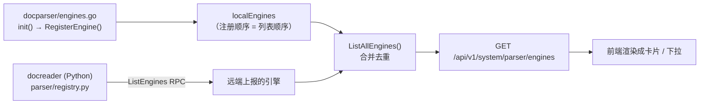
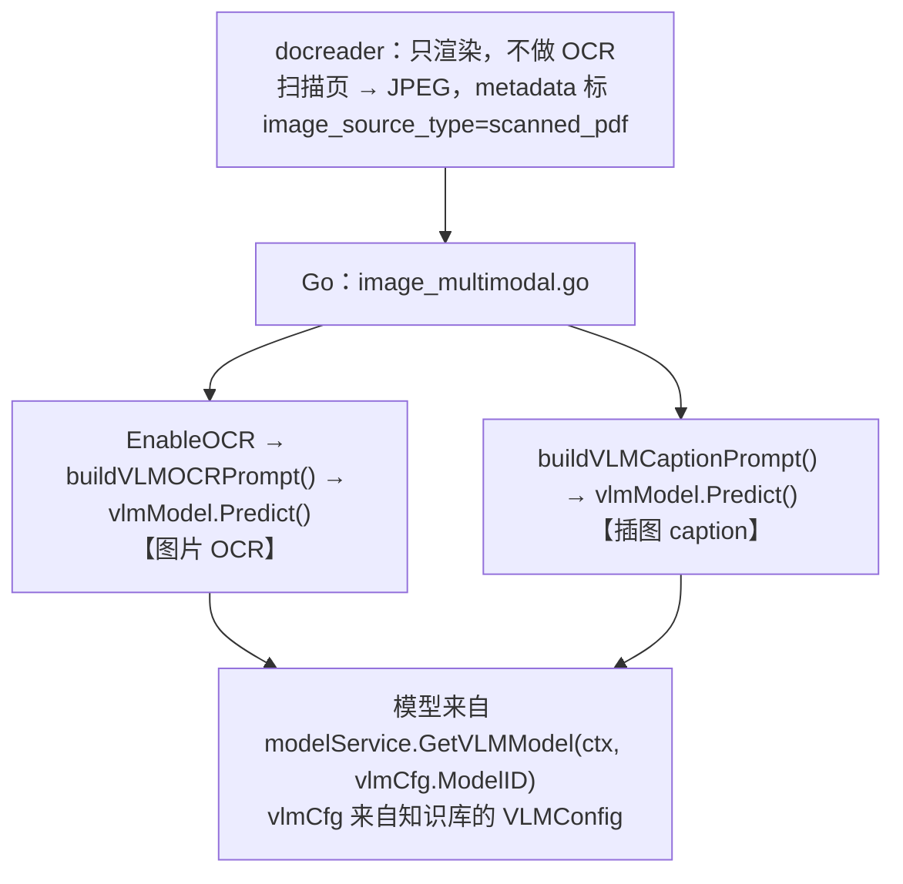

# WeKnora 解析引擎接入机制

> **适用问题**：「我想让 WeKnora 用某个外部文档解析 / OCR 服务，该在哪配？」
> **引用基线**：`@993d6560`（`wkj-dev`）。行号会随手漂移，核对时以符号名为准。

## 一、结论速览

1. **引擎列表由后端注册表产出**，前端只渲染 —— 想让「列表里多一个引擎」，改的是**后端**，不是前端某个配置项。
2. 引擎分两类：**Go 侧本地引擎**（能配 endpoint）与 **docreader 侧 Python 引擎**（**没有** endpoint 概念）。判据见 §三。
3. 接外部服务只有两条路：**对齐 WeKnora 已支持的协议**（零代码），或 **新增一个 Go 侧引擎**（要改官方文件）。
4. ★ **图片 OCR 不在解析引擎体系内** —— 它走知识库的「视觉模型」（协议仅 OpenAI / Ollama），
   docreader 侧**没有**任何 OCR 配置项。想让外部 OCR 服务干活，只能从解析引擎进。见 §六。

---

## 二、引擎列表从哪来

列表 = **Go 侧本地注册表** + **docreader 经 `ListEngines` RPC 上报的引擎**，两者合并在
`docparser.ListAllEngines()`。



| 层 | 注册点 | 现有成员 | 加引擎要不要改 Go 代码 |
|---|---|---|---|
| **Go 本地** | `docparser/engines.go` 的 `init()` → `RegisterEngine` | `builtin`、`simple`、`anydoc`、`weknoracloud`、`mineru`、`mineru_cloud`、`paddleocr_vl`、`paddleocr_vl_cloud` | 要 |
| **docreader 远端** | `docreader/parser/registry.py` 的 `_build_default_registry()` | `markitdown`、`opendataloader`（`builtin` 两边同名） | **不要**（远端追加即可） |

> 远端自动发现是刻意设计的（`engine_registry.go` 的注释原文：
> *"Remote engines not present locally are appended as-is, enabling auto-discovery of newly added
> docreader engines without Go changes."*）

**前端两个消费点，都是数据驱动的**：

- 全局「设置 → 解析引擎」：`views/settings/ParserEngineSettings.vue` —— 卡片列表来自 API；
- 知识库「解析设置」的按文件类型下拉：`views/knowledge/settings/KBParserSettings.vue` ——
  文件类型分组与可选项都是从各引擎的 `FileTypes` **动态汇总**的。

⇒ **后端注册了新引擎，两处 UI 会自动出现**，不用改前端列表。（只有配置抽屉的字段要手工加，见 §四。）

---

## 三、★ 判据：这个引擎能不能填外部地址

**「出现在列表里」≠「可配远程地址」。** 看它在哪一侧注册：

| 注册侧 | 判断特征 | 例子 | 能否配 endpoint | UI 表现 |
|---|---|---|---|---|
| Go `engines.go` | 实现了 `NewReader`，**自己发 HTTP** | `mineru`、`paddleocr_vl` | ✅ **能** | 抽屉里有地址输入框 |
| docreader `registry.py` | 走 gRPC 交给 Python 进程 | `markitdown`、`builtin`、`opendataloader` | ❌ **不能** | 只有「支持文件类型」 |

**`markitdown` 是典型的反例标本**：它是**微软 MarkItDown 库在 docreader 进程内运行**，
根本没有「服务地址」这个字段。UI 侧证据——`ParserEngineSettings.vue` 的

```ts
const CONFIGURABLE_ENGINES = new Set(['mineru', 'mineru_cloud', 'paddleocr_vl', 'paddleocr_vl_cloud'])
```

不含 `markitdown` ⇒ 点开它的抽屉**连「测试连接」按钮都不渲染**（该按钮的挂载条件是
「有配置字段」或 `builtin`）。

> **易错点**：看到 `markitdown` / `opendataloader` 这类**外部产品名**就容易以为「它是个可配的外部服务」。
> 实际上它们是**被集成进 docreader 的库**。名字像第三方 ≠ 可配地址。

---

## 四、引擎配置怎么存、怎么传

```
租户配置列 types.Tenant.ParserEngineConfig        (internal/types/tenant.go)
        │  ToOverridesMap()  → map[string]string（key 写死在方法体里）
        ▼
parser_engine_overrides                            (parse 请求体)
        │  MergeParserEngineOverrides(租户级, 上传级)
        ▼
ReaderDeps.Overrides  →  引擎构造函数读取（如 overrides["paddleocr_vl_endpoint"]）
```

**加一个新引擎，以下三处必须同步改**（缺一处就静默失效）：

| # | 位置 | 作用 |
|---|---|---|
| 1 | `internal/types/tenant.go` → `ParserEngineConfig` 结构体 + `ToOverridesMap()` | 字段持久化与传递 |
| 2 | `internal/application/service/parser_url_security.go` → `parserOutboundURLKeys` | 新 endpoint 键**必须加进去**，否则出站 URL 不过 SSRF 校验 |
| 3 | `internal/infrastructure/docparser/engines.go` | 常量 + `RegisterEngine` |

再加上引擎实现本身（converter），以及前端配置抽屉的字段。

> **SSRF 白名单**：内网地址还要进 `SSRF_WHITELIST` 环境变量（`deploy/deploy-wkj-dev.sh`
> 已写入 `…,10.168.1.110,10.168.1.111`），支持精确域名、通配、IPv4/IPv6、CIDR。

---

## 五、现有引擎的协议清单

| 引擎 | 注册侧 | 端点 / 协议 | 输出 |
|---|---|---|---|
| `builtin` | Go（转发给 docreader） | gRPC `ReadStream` → docreader | markdown + 图片 |
| `simple` | Go | 进程内，无外部服务 | markdown |
| `anydoc` | Go | 进程内 cgo（Rust 库） | markdown |
| `weknoracloud` | Go | WeKnoraCloud 签名请求 | markdown |
| `mineru` | Go | 自建 MinerU HTTP API | markdown |
| `mineru_cloud` | Go | MinerU 云 API | markdown |
| **`paddleocr_vl`** | Go | **`POST {endpoint}/layout-parsing`**，JSON + base64 文件 | `result.layoutParsingResults[].markdown.{text,images}` |
| `paddleocr_vl_cloud` | Go | 百度 AI Studio 云 API | 同上 |
| `markitdown` | docreader | 进程内库 | markdown |
| `opendataloader` | docreader | 进程内 JVM（可挂 hybrid HTTP 服务） | markdown |
| `builtin`(docreader) | docreader | 进程内（pdfium 等） | markdown + 图片 |

**`paddleocr_vl` 的契约要点**（接入同类服务时照这个对齐）：

- 请求：`{ file: <base64>, fileType: 0|1, visualize: false, … }`，`fileType` 0=PDF、1=图片；
- 响应：`result.layoutParsingResults[].markdown.text` + `.images`，**逐页一项**，由 WeKnora 合并；
- 超时 1000s（为整份扫描件留的）；可用性探测 = `GET {endpoint}/layout-parsing`。

---

## 六、★ 图片 OCR 走的是另一条通道（易误判）

**结论：图片 OCR —— 包括扫描件 PDF 的页图 —— 不在解析引擎体系内，也没有「OCR 引擎」可配。**



**两条硬约束**决定了「把 PP-OCRv6 配成图片 OCR」为什么做不到：

1. **docreader 不做 OCR**。镜像构建已移除 OCR / PaddleOCR 依赖（`docker/Dockerfile.docreader`），
   `image_parser.py` 注释明确 **"不做任何 OCR"**。它只把扫描页渲染成图片，OCR 交给 Go 侧。
   ⇒ **docreader 没有任何 OCR 配置项可填**。
2. **视觉模型通道只认两种协议**。`internal/models/vlm` 的 `Config.InterfaceType` 仅
   `"openai"`（默认）或 `"ollama"`，且模型只能从 `models` 表里选（`VLMConfig.ModelID`）。
   110 的 `POST /api/ocr`（multipart、自有参数）**不属于任何一种** ⇒ 无论怎么填都接不上。

⇒ **想让 PP-OCRv6 处理扫描件，唯一的入口是解析引擎**（`paddleocr_vl` → `/layout-parsing`），见 §八。
走通之后，扫描件的 OCR **不再依赖视觉模型**；
但**插图 caption 仍走视觉模型**（上图第二个分支），建议保留该配置。

---

## 七、接入外部服务：两条路

### 路线 A · 对齐已有协议（推荐，零代码）

对方服务若能提供 `/layout-parsing` 形态的文档解析接口，**零代码**：
设置 → 解析引擎 → 「PaddleOCR-VL（自建）」→ 填 endpoint → 测试连接 → 保存。
再在知识库解析设置里，把 `pdf`（或图片类型）的引擎指定为该引擎。

**适配判据**（三条全中才算对齐）：

1. 端点路径是 `/layout-parsing`；
2. 请求是 JSON + base64 的 `file` / `fileType`；
3. 响应含 `result.layoutParsingResults[].markdown.text`。

### 路线 B · 新增一个 Go 侧引擎

对方协议不对齐、且无法在对方侧改造时走这条。改动面见 §四 + 引擎实现 + 前端抽屉字段，
**涉及多处官方文件修改** ⇒ 与仓库「官方文件保持原样」的约束冲突，需明确决策。

---

## 八、案例：接 110 的 PP-OCRv6 GPU

110 上现有一个自建服务 `pp-ocr-v6-gpu-api`（`10.168.1.110:36741`），
接口是 `GET /api/health` + `POST /api/ocr`（**multipart/form-data**，`image=@file`），
响应 `results[].text`。**它是纯 OCR，不是文档解析产线。**

### 8.1 为什么它接不上

| 维度 | 110:36741 | WeKnora `paddleocr_vl` 契约 |
|---|---|---|
| 入口 | `POST /api/ocr` | `POST /layout-parsing` |
| 传输 | multipart/form-data | JSON + base64 |
| 响应 | `results[].text` | `result.layoutParsingResults[].markdown.text` |
| 输入 | **仅图片**（png/jpeg/webp/bmp/gif） | pdf + 图片 |
| 输出语义 | 纯文本行 | 版面 / 表格 → markdown |
| 吞吐 | 串行 ≈1 张/s、429 限流、pipeline 缓存 6 组 | 单次整份 PDF、超时 1000s |

⇒ 它既不是解析引擎协议，也不是视觉模型协议（§六）⇒ **纯配置接不上**。

### 8.2 ★ 不改 WeKnora 源码的三条路

前置认知：**WeKnora 侧要的只是一个 `/layout-parsing` 形态的端点**。
只要 110 侧能提供它，**WeKnora 一行代码不用改**。

| 方案 | 110 侧要做的事 | 能处理纯图片 PDF | 输出质量 |
|---|---|---|---|
| **A（推荐）** | 起 PP-StructureV3 产线：`paddlex --serve --pipeline PP-StructureV3 --device gpu:0 --port 36742` | ✅ 原生吃 PDF（`fileType=0`） | ★★★ 版面 / 表格 / 阅读顺序 |
| **B** | 给 36741 加一个 `/layout-parsing` 兼容端点（约 40 行；PDF 还要自己拆页渲染） | ⚠️ 需自行拆页 | ★ 纯文本行 |
| **C** | 独立写一个协议转换小服务（同 B，只是换个进程） | ⚠️ 需自行拆页 | ★ 纯文本行 |

**方案 A 为什么是最优**：

- **响应字段天然对齐** —— WeKnora 读 `layoutParsingResults[].markdown.{text,images}`，
  PP-StructureV3 官方文档的响应结构**就是这个**（`markdown.text` / `markdown.images` / `isStart` / `isEnd`）；
- **PP-OCRv6 已经在里面** —— PP-StructureV3 的「通用 OCR 子产线」官方已集成 PP-OCRv6
  （文档原文：*"General OCR Sub-Pipeline … PP-OCRv6_medium, PP-OCRv5_server"*）
  ⇒ **既用上 PP-OCRv6，又拿到版面结构**；
- **原生支持 PDF**，不需要自己拆页；
- 110 与 WeKnora 的职责干净分离：**OCR 能力留在 110，WeKnora 只当消费方**。

### 8.3 本地实测：客户端侧风险已排除

用 mock 服务模拟 PP-StructureV3 的 `/layout-parsing`（响应结构照抄官方文档），
跑 WeKnora 真实的 `PaddleOCRVLReader`：

**① WeKnora 实际发出的请求**

```
POST /layout-parsing          Content-Type: application/json
共 21 个字段：
  file / fileType(=0 即 PDF) / visualize(=false)
  + 18 个参数：promptLabel, temperature, topP, repetitionPenalty,
    minPixels, maxPixels, useLayoutDetection, useDocOrientationClassify,
    useDocUnwarping, useSealRecognition, useChartRecognition,
    useOcrForImageBlock, markdownIgnoreLabels, mergeTables, relevelTitles,
    restructurePages, layoutShapeMode, layoutNms
```

**② 对 PP-StructureV3 风格响应的解析：成功**

2 页 markdown 被正确合并，**表格原样保留**：

```
# 扫描件首页

这是第一页的正文。

| 项目 | 金额 |
| --- | --- |
| 合计 | 100 |

## 第二页

续页正文内容。
```

⇒ **客户端侧无风险**：只要服务端返回 `result.layoutParsingResults[].markdown.text`，
WeKnora 就能正确落成 markdown。

**仍待对真实服务实测的一点**：请求里那 18 个参数多为 PaddleOCR-VL 专有
（`promptLabel` / `minPixels` / `restructurePages` …），PP-StructureV3 的 Pydantic 请求模型
是否容忍多余字段 —— **默认行为是忽略，但未对真实服务验证**。
其中 `file` / `fileType` / `visualize` 是 PP-StructureV3 官方原生入参，这部分确定没问题。

### 8.4 若坚持直连 36741

需走路线 B（改官方文件），**并且要接受三个能力缩水**：

- **不能处理 PDF** —— 只接图片（PDF 得另配「渲染成页图再逐页送 OCR」的链路）；
- **丢失版面结构** —— 纯文本行流，下游分块质量下降；
- **吞吐冲突** —— 服务端串行 ≈1 张/s + 429 限流，而 WeKnora 的 converter **没有退避重试**。

**两套服务并行**是更干净的形态：36741 继续做「给人 / 给脚本用的独立 OCR」
（多档对比、429 退避、结构化日志都做得好），WeKnora 走独立的 PP-StructureV3 产线。

---

## 九、坑位

1. **「测试连接」会假阳性**。`PingPaddleOCRVL` 只发 `GET {endpoint}/layout-parsing`，
   判定标准是 **`statusCode < 500`** ⇒ 把端点填成一个「没有该路径」的服务（返回 404）时，
   UI 照样显示**可用绿灯**，但真解析必然失败。**别用这个灯当验收判据**。
2. **内网地址要进 `SSRF_WHITELIST`**，否则 endpoint 在保存或解析阶段被拦。
3. **`markitdown` 之类不在此列** —— 见 §三，它们没有 endpoint。
4. **改了 Go 侧注册表，前端两处列表会自动出现**，但配置抽屉的字段要手工加；
   若漏改 `parser_url_security.go`，保存时不报错、解析时静默失败。
5. **图片 OCR 与解析引擎是两条通道** —— 配置视觉模型不会影响扫描件的解析引擎行为，
   反之亦然。排查「扫描件没出文字」时先确认走的是哪条路，见 §六。
